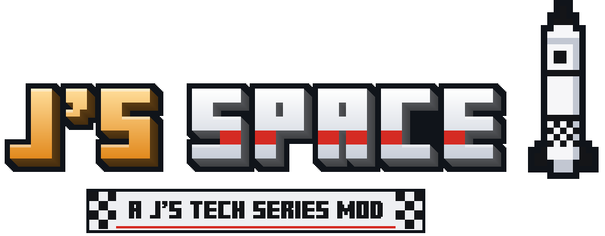

# J's Space

Rockets, satellites, the worlds of the Solar System and of other stars, and the starships that reach them.
This is the space mod of the [J's Tech Series](../README.md); its id is `jsspace`.

## What is J's Space?

J's Space takes the player off the Overworld: first in a rocket built part by part and flown the way a real one is,
to the Moon and to Mars, and later in starships built of modules, to the worlds of other stars. Like every mod of the
series, it can be played alone, with J's Core under it; played with the other mods of the series, it works with all
of them.

## Where it is

J's Space is only starting, and it adds nothing to the game yet. The first part being built is its base: the Moon and
Mars, a rocket trip made the way the mod will really make it, and a small ship with the shipyard that builds it.

How each of its systems works, and why, is in [its design](docs/design/README.md), one page per subject.

## Requirements

- Minecraft 1.21.1 and NeoForge 21.1.248 or newer.
- [J's Core](../core/README.md) at the same version (required).

It needs no other mod of the series.
